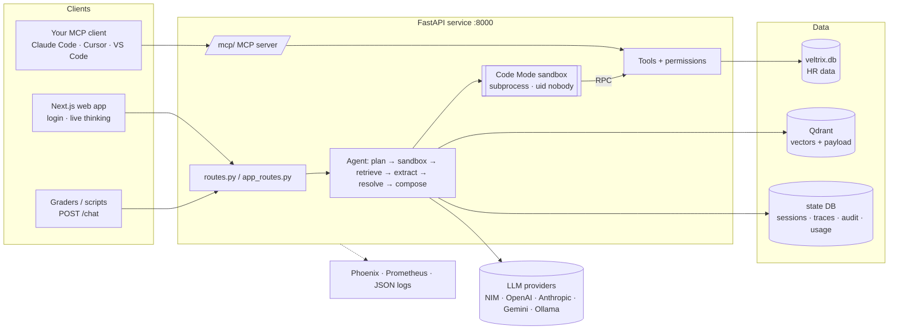
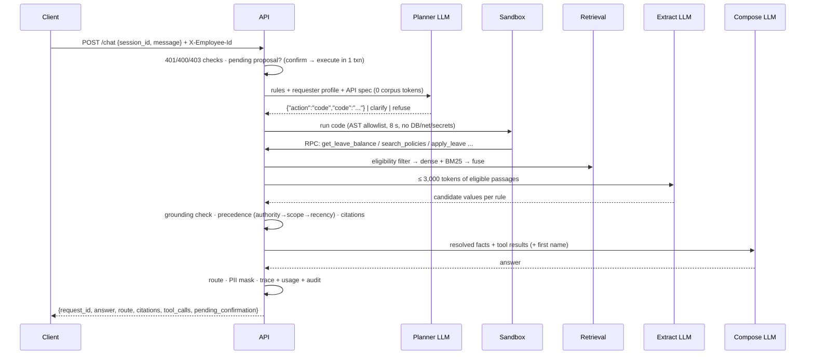
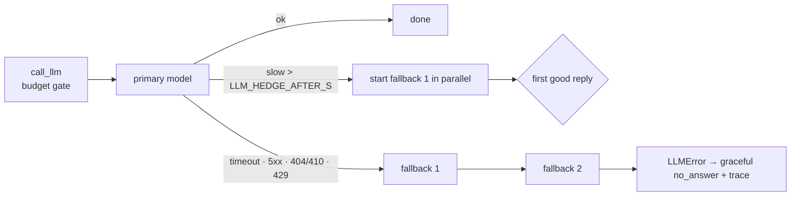

# Architecture

This document covers the system design behind the assessment: request flow, Code Mode and its
security model, LLM resilience (fallback and hedging), token economics, observability, the MCP
integration, and how the system scales. [DESIGN.md](DESIGN.md) answers the seven questions the task
asks; this is the wider view.

## 1. Constraints that shape the design

| Constraint (TASK.pdf) | Design consequence |
|---|---|
| Exact `/chat` contract, graded automatically, 30 s limit | Deterministic routing, citations and tool lists built in code. A 26 s internal deadline that always returns an answer and saves a trace. |
| ≤ 3,000 corpus tokens per LLM call | The model never sees passages until a budgeted pack step. One gate (`call_llm`) refuses anything over budget. |
| Restricted docs must never reach the LLM | Eligibility is a retrieval filter (inside Qdrant), not a post-filter. |
| Graders run a modified corpus and DB | Nothing from the corpus is in code or prompts. Holidays, precedence inputs and locators are all derived at ingestion. The scanned document is OCR'd with RapidOCR (ONNX, CPU, no system packages). |
| Permissions must not depend on the model | Every tool takes a server-side `ToolContext` built from the header or token. The model only supplies arguments. |
| Works with OpenAI / Anthropic / Gemini | A provider-neutral `LLMClient`. `LLM_PROVIDER=auto` picks whichever key is set. |

## 2. System context

## 3. Request lifecycle

The `/chat/stream` endpoint runs the same pipeline and emits each step as Server-Sent Events. The
UI's "thinking" view is built from these events. The final event is the `/chat` body.

## 4. Code Mode and its security model

The planner writes one short Python program against a typed API (the 5 contract tools plus
helpers) instead of making one tool call per model turn.
- **Benefits:** one round trip for chained logic (balance → policy → projection), and the model
  is working in a language it is well trained on.
- **Costs:** a sandbox has to be designed. It is described below.

| Threat | Control |
|---|---|
| Arbitrary code execution | AST allowlist: no import, def, class, lambda, dunder access, `eval`/`open`/`getattr`, or `.format` |
| Escaping the allowlist | Separate process with an empty environment (no API keys). On Linux it drops to uid 65534 with limits on CPU (5 s), memory (512 MB), file writes (0) and processes. 8 s wall-clock timeout. |
| Data access beyond permissions | The child has no database handle. Every function is an RPC to the parent, which checks permissions using the requester's real identity. |
| Writes without consent | `apply_leave` / `cancel_leave` only validate and propose. Writes happen only after an explicit confirmation in the next message, re-checked inside one transaction. |
| Model fills in a leave type | A server-side guard: the type must come from the current request. |
| Bulk extraction by looping | The tool layer allows at most one other employee per message. |

## 5. LLM resilience

- **Provider abstraction:** one OpenAI-compatible client (NIM, OpenAI, Gemini, Ollama) and a
  native Anthropic client. Unsupported parameters (JSON mode, `max_tokens`, `temperature`, `seed`,
  `extra_body`) are adapted after the first 400 and remembered per client.
- **Fallback chain:** `LLM_FALLBACK_MODELS`. The NIM defaults are Lightning → Bolt → Ultra.
- **Hedged requests:** if the primary hasn't answered after 4 s, the next model starts in parallel.
  This was measured to remove the long-tail timeouts on NIM's free tier, whose latency ranged from
  1 s to over 30 s.
- **Time budget:** each call gets at most `LLM_TIMEOUT_S` (20 s). The request deadline is 26 s,
  inside the 30 s contract. A missed deadline returns a polite `no_answer` with the trace saved,
  never an HTTP error.
- **Telemetry:** every call records its attempt chain (`model · outcome · ms`). It shows in the
  chat's thinking panel, the trace, `llm_usage`, and the *Architecture & usage* page.
- **Runtime switching:** `POST /llm` (or Settings) changes the provider, model and agent mode
  without a restart. `POST /llm/test` probes an exact model first; for example, it shows that
  `openai/gpt-oss-120b` returns 410 Gone on NIM.

## 6. Token economics

**Accounting:** one row per LLM call in `llm_usage`:
- provider, requested model and answering model, purpose;
- prompt, completion and corpus tokens, latency, outcome, attempt chain.

It is exposed through `GET /usage` and the *Architecture & usage* page (calls, tokens per day,
per-step and per-model tables, corpus-budget histogram, recent calls), alongside Prometheus
counters and histograms.

Measured on NIM Nemotron 3.5 Lightning (live run, 15 calls):

| Step | Avg prompt tokens | Avg completion | Corpus tokens | Notes |
|---|---|---|---|---|
| plan | ~2,550 | ~40 | 0 | system rules + API spec + requester profile + calendar |
| extract | ~2,100 | ~160 | 900–1,500 (max 3,000) | only step that sees passages |
| compose | ~770 | ~65 | facts only (~40) | resolved values, not passages |

**Cost levers, in order of impact:**
1. Provider prompt caching of the static planner prefix: it is about 80% of plan tokens and is
   identical across requests.
2. Skip compose for template answers. Proposals, confirmations and refusals already skip it.
3. A smaller planner model with a larger compose model.
4. Tighter `k` in retrieval: about 35 tokens saved per dropped passage.

Cost per request ≈ Σ(prompt × in-price + completion × out-price). The usage table already has the
token counts by model, so a price sheet is the only missing input.

## 7. Observability and traceability

| Signal | Where | Content |
|---|---|---|
| Trace per answer | `GET /traces/{request_id}` · UI drawer | Steps with timings, generated code, sandbox calls, permission decisions, retrieval and evidence, extracted candidates, dropped (ungrounded) values, precedence decisions, every LLM call with tokens and fallbacks |
| OTel spans | Phoenix (`--profile full`) | `llm.*` spans with OpenInference attributes, plus tools, retrieval, sandbox and ingestion per document |
| Logs | stdout JSON | request/session/employee/trace IDs; `corpus_tokens` on every LLM call; PII scrubbed |
| Metrics | `GET /metrics` | latency, routes, tool outcomes, LLM latency/tokens, corpus-token histogram, sandbox outcomes |
| Audit | `audit_events` | every tool call with masked arguments and its permission outcome (chat, REST dashboards and MCP) |
| Usage | `llm_usage` · `GET /usage` | token consumption, latency, fallbacks, errors |

**Suggested SLOs:**
- p95 `/chat` under 15 s;
- error route rate under 1%;
- fallback rate under 20%, with an alert above that;
- `max(corpus_tokens) ≤ 3000` (a hard invariant: alert on any violation).

## 8. MCP: bring your own client

The API is also a **Model Context Protocol server** (Streamable HTTP at `/mcp/`, MCP Python SDK
2.x), so users can drive it from Claude Code, Cursor, VS Code, Claude Desktop or their own agents.

- **Tools:**
  - `whoami`, `ask_hr_assistant` (the full agent, including the confirmation step through `session_id`);
  - `get_leave_balance`, `list_leave_requests`, `get_team_leave`;
  - `list_holidays`, `list_documents`, `search_hr_documents`.
- **Auth:** a personal Bearer token (30 days) from *Settings → Integrations* (`POST /me/mcp-token`).
  That endpoint also returns ready-made configs for each client.
- **Same guarantees as the chat:** every tool resolves the employee from the token and calls the
  same `ToolContext` and eligibility functions. Restricted documents never appear, other employees
  get the fixed refusal, and every call is audited. Errors are surfaced as MCP `ToolError`s;
  unexpected exceptions are hidden by the SDK.
- **Transport security:** DNS-rebinding protection with an allow-list of hosts and origins
  (`MCP_ALLOWED_HOSTS`). The server is stateless, so it scales horizontally.
- **Roadmap:** OAuth 2.1 authorization-server metadata as defined in the MCP spec (the SDK's
  `token_verifier` / `auth` settings), token revocation, and scopes such as `read:leave` and
  `write:leave`.

## 9. Identity, time and personalisation

- **Identity:** always the database record for the `X-Employee-Id` header (API) or a signed token
  (UI, MCP). The planner gets the requester's profile:
  - role, region, level, join date and length of service;
  - manager ID and direct-report IDs;
  - today's date and the current time in `APP_TIMEZONE`.

  So "I", "my team" and "my manager" resolve correctly, and "who am I?" is answered from the
  record.
- **Time:** the UI shows the user's computer clock and flags when the assistant's date
  (`APP_TODAY` / server timezone) differs from it.
- **Names:** the planner never gets names. The compose step gets only the requester's own first
  name.

## 10. Scaling and operations

| Load | Change |
|---|---|
| Several API replicas | Move session locks and proposals to Redis (the state DB tables become Postgres). The MCP server is already stateless. |
| 10k+ documents | Ingestion worker and queue, content-hash incremental indexing, Qdrant sparse vectors instead of BM25, payload indexes, document families, reranker (see DESIGN.md §7) |
| Provider quotas | Per-tenant rate limits, a circuit breaker per model (skip a model after N failures for T seconds), prompt caching |
| Compliance | Retention jobs for traces and audit, export of audit events, OAuth for MCP, a key vault for provider keys |

## 11. Key decisions

| Decision | Alternatives | Why |
|---|---|---|
| Code Mode planner + deterministic precedence | Let the LLM decide precedence | The precedence rules are exact and graded. Code is testable; the model only lists candidates. |
| Retrieval-time eligibility filter | Post-filtering results | The task forbids restricted text reaching the model at all. |
| Section chunks + hybrid retrieval | Fixed windows; dense only | Exact locators; BM25 catches exact policy terms; the per-retriever top-3 protects OCR text. |
| SQLite state DB | Postgres / Redis | Zero extra services for the grader. The interface is small enough to swap. |
| Hedging over a single long timeout | One retry | Free-tier latency is heavy-tailed; hedging cuts the tail without doubling cost on fast calls. |
| MCP over a custom SDK | Bespoke REST client | A standard protocol that every major agent client already speaks. |
