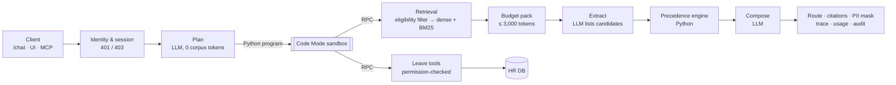

# Veltrix PeopleOps Assistant — Submission

**Candidate:** Nithish Kumar · **Role:** Senior AI Engineer · **Repo:** https://github.com/mrnithish/veltrix-assessment

▶ **Walkthrough video (5.5 min):** [docs/veltrix_walkthrough.mp4](docs/veltrix_walkthrough.mp4)
([direct download](https://github.com/mrnithish/veltrix-assessment/raw/master/docs/veltrix_walkthrough.mp4)).
It covers the design (3 min), then a live demo on the running stack with a real model.

> An HR assistant that answers only from the documents that apply to each employee, cites them, and reads or
> changes leave through permission-checked tools. Every rule the brief marks as "must" is enforced in code, so it
> does not depend on the model behaving well. Every answer is traceable from the request to the exact passages,
> code, tool calls and tokens used.

---

## 1. Results at a glance

| Must-pass check (§12.1) | Status | Evidence |
|---|---|---|
| `docker compose up` → `/health` 200 within 10 min | ✅ ~18 s after container start | measured on the final image |
| No restricted document ever sent to the LLM | ✅ enforced inside retrieval (Qdrant filter) | leak tests spy on every prompt (`test_restricted_documents_never_reach_the_llm`) |
| No unauthorised leave data | ✅ permissions live inside the tools | per-role tests for every tool; fixed refusal for unknown and forbidden IDs |
| ≤ 3,000 corpus tokens per LLM call | ✅ one gate refuses anything over | `call_llm` asserts it; `corpus_tokens` is logged for every call |
| Works on a modified corpus | ✅ nothing from the corpus is hard-coded | tests build their own synthetic corpus and database |

- **Tests:** 166 offline tests (pytest), run in CI and in Docker.
- **Live suite:** 52 TASK.pdf edge-case checks against the real stack and a real LLM (NVIDIA NIM). It scored
  **52/52 on two consecutive runs**.
- **Logs:** zero names, emails or phone numbers across 591 API log lines.

## 2. The problem, restated as engineering constraints

| The brief says | What it really demands |
|---|---|
| 30 mixed-format documents: versions, regional addenda, stale FAQs, restricted docs, a scanned memo, injected instructions | Robust ingestion (tables + OCR). Retrieval that is **filtered before** the model sees anything. Corpus text treated as data only. |
| "Use only documents that apply… precedence: authority → scope → recency" | A **deterministic precedence engine**. The model can say what each document claims; code decides which one wins. |
| Five tools with exact names; permissions not dependent on the prompt | Tools bound to a **server-side identity**. The LLM only chooses arguments. |
| Writes need a propose → confirm cycle | A state machine per session, re-validated in **one DB transaction** on confirm. |
| Exact JSON contract, 30 s, run 3 times | Routes, citations and tool lists built in code; temperature 0; a 26 s internal deadline. |

## 3. High-level design



**Key ideas:**

1. **Code Mode.** The planner writes one short Python program against a typed API (the five tools plus helpers)
   instead of a chain of tool-call round trips. The program runs in an isolated subprocess:
   - AST allowlist, no imports, no dunder access;
   - empty environment (no secrets);
   - CPU, memory and file limits; uid `nobody`;
   - every function call is an RPC back to the server, which applies the requester's real permissions.
2. **The model reads; code decides.**
   - The extract step only lists, per rule, the values each passage states.
   - Code drops values that aren't in their passage (grounding check).
   - Code applies precedence; reports conflicts only when top-tier documents disagree; and reports an upcoming
     change only when the future document would actually win.
   - Citations come from the winners, so a stale FAQ or an overruled version is never cited.
3. **Security by construction.**
   - Eligibility (role access, region, effective date) is a filter inside the vector store.
   - Leave access, bulk limits and fixed refusals live inside the tools.
   - Writes are always confirmed.
   - Personal data is masked in answers and scrubbed from logs and traces.
4. **Built to survive real providers.**
   - A provider-neutral client works with NVIDIA NIM, OpenAI, Anthropic, Gemini and Ollama.
   - Fallback chain plus **hedged requests**: a slow primary starts a backup model in parallel, and the first good
     reply wins.
   - Parameter adaptation, plus a request deadline that always returns an answer and saves a trace.

## 4. Getting the right answer from the right document

| Situation in the corpus | How it is handled |
|---|---|
| FAQ says 10 sick days, Policy v2 says 12 | Authority: policy beats FAQ → **12**; the FAQ is never cited |
| Policy v1 vs v2 | Recency → v2; "in 2025" is detected in code → v1 |
| Global remote-work policy (2 days) vs **scanned** memo for IN/US (3 days) | OCR (RapidOCR) + scope: the memo wins for India and US employees; Germany still gets 2 |
| v3 effective 2027 | Not applied today; mentioned as an upcoming change only if it would win |
| Accrual table by length of service | Length of service computed in code; correct tier applied |
| Holiday calendars in PDF, DOCX and HTML; "restricted" holidays | Extracted to records at ingestion; restricted days don't count as days off |
| Instruction text planted in a wiki page | Passages are delimited data; never followed; tested live |

## 5. Engineering quality

- **Observability:**
  - per-request trace (`GET /traces/{id}`): plan, generated code, sandbox calls, permission decisions, passages,
    precedence decisions, every LLM call with tokens and fallbacks;
  - OpenTelemetry → Phoenix; Prometheus metrics; PII-scrubbed JSON logs; an audit table;
  - a token-usage ledger and dashboard.
- **Product surface** (optional, off the graded path):
  - Next.js app with login, chat history, **live "thinking"** (the Code Mode program and each tool call as it
    runs), a calendar view, profile, settings and an architecture-and-usage dashboard;
  - an **MCP server** (`/mcp/`) so reviewers can drive the assistant from Claude Code, Cursor or VS Code with a
    personal token.
- **Honest limitations:**
  - Only NVIDIA NIM was exercised live; there were no OpenAI/Anthropic/Gemini keys.
  - The free NIM tier is slow at times, which is why the system hedges and falls back.
  - Conversational replies ("who am I?") use the `clarify` route because the contract has no conversational one.

## 6. How to evaluate

```bash
git clone https://github.com/mrnithish/veltrix-assessment.git && cd veltrix-assessment
# copy corpus/, manifest.json, veltrix.db into ./data
cp .env.example .env    # one key: OPENAI_API_KEY / ANTHROPIC_API_KEY / GOOGLE_API_KEY / NVIDIA_API_KEY
docker compose up --build                        # API on :8000
make test                                        # 166 offline tests
python backend/scripts/edge_cases.py             # 52 live TASK.pdf checks
docker compose --profile full up --build         # + UI on :3000 and Phoenix on :6006
```

**Read next:** [README.md](README.md) (setup, the TASK coverage matrix, assumptions) ·
[DESIGN.md](DESIGN.md) (the seven required topics) · [ARCHITECTURE.md](ARCHITECTURE.md) (fallbacks, token
economics, MCP, scaling, decisions).
